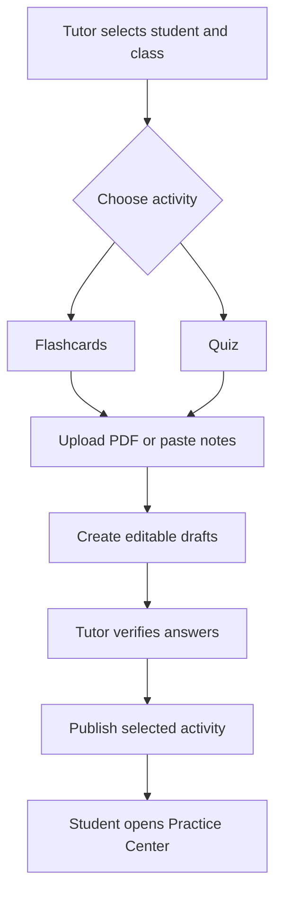
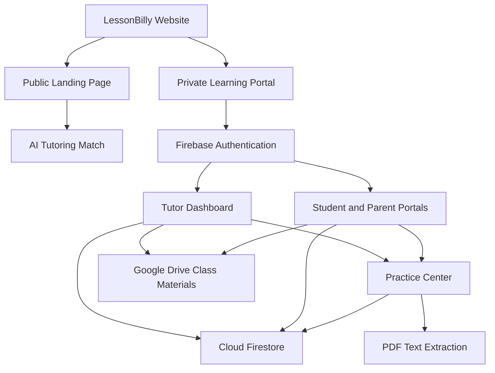

# LessonBilly

**Personalized online tutoring with interactive practice, progress tracking, and private learning portals.**

LessonBilly is a full-stack online tutoring platform built with React, Vite, Firebase, and Cloudflare Pages.

It combines a public tutoring website with private portals for tutors, students, and parents. Students can access class materials, complete tutor-reviewed practice activities, and monitor their academic progress.

The platform focuses on making tutoring more organized, accessible, and personalized for K-12 students.

---

## Explore LessonBilly

- [Features](#features)
- [Interactive Platform Tour](#interactive-platform-tour)
- [How Practice Center Works](#how-practice-center-works)
- [System Architecture](#system-architecture)
- [Technology Stack](#technology-stack)
- [Local Setup](#local-setup)
- [Deployment](#deployment)
- [Security and Privacy](#security-and-privacy)

---

## Features

| Feature | Description |
|---|---|
| Personalized tutoring | One-on-one remote tutoring for K-12 students |
| Tutor dashboard | Manage students, classes, schedules, and grades |
| Student portal | Access lessons, materials, grades, and practice |
| Parent portal | Monitor published academic progress |
| Practice Center | Interactive flashcards and multiple-choice quizzes |
| Independent publishing | Upload and publish quizzes and flashcards separately |
| PDF activity creation | Extract structured practice content from text-based PDFs |
| AI Tutoring Match | Suggests potential tutoring subjects based on academic challenges |
| Class materials | Share homework and classwork through Google Drive links |
| Lesson scheduling | Class-specific Google Meet links and lesson durations |
| Progress tracking | Publish assessment scores and feedback |
| Responsive design | Desktop and mobile layouts with scroll animations |

### Built for Three Types of Users

**Tutor**
- Create and manage student records.
- Add multiple classes for each student.
- Schedule remote lessons.
- Upload and publish practice activities.
- Manage assessment grades and class materials.

**Student**
- Access assigned classes.
- Review published flashcards.
- Complete multiple-choice quizzes.
- View published grades and tutor feedback.
- Access class materials and meeting links.

**Parent**
- Monitor student progress.
- View published assessment scores.
- Access class schedules and materials.
- Review tutor-approved practice activities.

---

## Interactive Platform Tour

Explore the platform by expanding the sections below.

<details>
<summary><strong>1. Tutor Dashboard - Managing Students</strong></summary>

### Student Management

The tutor dashboard provides tools for managing students and their classes.

Available functionality includes:

- Creating student records.
- Updating grade levels.
- Managing multiple subjects per student.
- Linking verified parent and student accounts.
- Creating and publishing assessment grades.
- Scheduling Google Meet sessions.

Each class maintains its own schedule, materials, assessments, and practice activities.

</details>

<details>
<summary><strong>2. Practice Center - Flashcards</strong></summary>

### Interactive Flashcards

The tutor can upload a text-based PDF containing flashcards or enter questions and answers manually.

Supported format:

```text
CARD|What is a numerator?|The top number in a fraction.
CARD|What is a denominator?|The bottom number in a fraction.
```

The system extracts the question-and-answer pairs into editable flashcard drafts.

The tutor reviews all 10 flashcards before publishing.

Students can then flip through cards, reveal answers, and move between questions.

**Flashcards can be published without creating a quiz.**

</details>

<details>
<summary><strong>3. Practice Center - Multiple-Choice Quizzes</strong></summary>

### Interactive Quizzes

The tutor can upload a separate PDF containing multiple-choice questions.

Supported format:

```text
QUIZ|What is the numerator in 3/8?|3|8|11|5|1|The numerator is the top number.
```

Each quiz question includes:

- One question.
- Four answer choices.
- One correct answer.
- An optional explanation.

The tutor reviews all 10 questions before publishing.

Students can select an answer, check their response, and receive immediate feedback.

Their practice attempts are not stored in Firestore.

**Quizzes can be published without creating flashcards.**

</details>

<details>
<summary><strong>4. Parent and Student Portals</strong></summary>

### Private Learning Access

Parents and students use separate sign-in interfaces.

Firebase Authentication verifies accounts, while Cloud Firestore Security Rules restrict access to authorized student records.

Parents and students can access their linked records and published materials.

The tutor controls which assessment scores and practice activities become available.

Unpublished grades remain private to the tutor.

</details>

<details>
<summary><strong>5. AI Tutoring Match</strong></summary>

### Find a Potential Tutoring Focus

The public website includes a lightweight machine-learning feature that helps prospective families explore tutoring options.

Visitors can provide:

- Student grade level.
- Academic subject.
- Learning challenge.
- Tutoring goal.
- Preferred weekly tutoring hours.

A browser-based Naive Bayes text classifier suggests a possible tutoring subject using example training descriptions.

The feature also generates an illustrative tutoring plan and a message that families can choose to send.

The classifier:

- Runs directly in the browser.
- Does not require an external AI API.
- Does not require a GPU.
- Does not have a daily AI token quota.

It is not a diagnostic assessment or a replacement for a tutor.

</details>

---

## How Practice Center Works

Practice Center uses a tutor-reviewed workflow rather than automatically publishing generated answers.

### Activity Publishing Workflow



### Independent Activity Publishing

Flashcards and quizzes are managed separately.

| Action | Flashcards | Quiz |
|---|---|---|
| Upload flashcard PDF | Updated | Unchanged |
| Upload quiz PDF | Unchanged | Updated |
| Publish flashcards | Published | Unchanged |
| Publish quiz | Unchanged | Published |

Each class supports a set of 10 flashcards and a separate set of 10 multiple-choice questions.

Publishing one activity does not overwrite the other.

Existing published activities stay available while the tutor prepares new drafts.

### Privacy-Friendly Practice

PDF text is processed in the browser to prepare practice drafts.

Only approved activity content is saved to Firestore when published.

Student practice responses and scores are maintained temporarily in the browser and are not stored in Firestore.

---

## System Architecture

LessonBilly uses a React frontend, Firebase Authentication, Cloud Firestore, and Cloudflare Pages.



### Architecture Highlights

**Frontend:** React components handle the public website, dashboards, activity editors, and student practice interfaces.

**Authentication:** Firebase Authentication provides email/password sign-in and email verification.

**Database:** Cloud Firestore stores student records, class information, assessment grades, and published practice activities.

**Security:** Firestore Security Rules enforce tutor permissions and linked student/parent access.

**Hosting:** Cloudflare Pages hosts the frontend using a production Vite build.

**PDF processing:** PDF.js extracts text from uploaded practice PDFs in the browser.

---

## Technology Stack

| Category | Technology |
|---|---|
| Frontend | React 19 |
| Build Tool | Vite |
| Language | JavaScript / JSX |
| Authentication | Firebase Authentication |
| Database | Cloud Firestore |
| Animations | Motion |
| Icons | Lucide React |
| PDF Processing | PDF.js |
| Hosting | Cloudflare Pages |
| Version Control | Git and GitHub |

### Project Structure

```text
LessonBilly/
├── src/
│   ├── App.jsx
│   ├── ClassDelete.jsx
│   ├── ClassMaterials.jsx
│   ├── DriveMaterials.jsx
│   ├── FeatureShowcase.jsx
│   ├── firebase.js
│   ├── index.css
│   ├── learningClassifier.js
│   ├── LearningNeedsAssistant.jsx
│   ├── main.jsx
│   ├── PracticeCenter.jsx
│   ├── StudyChat.jsx
│   └── TutorGuide.jsx
├── worker/
│   └── src/
│       └── index.js
├── firestore.rules
├── index.html
├── package.json
├── README.md
└── vite.config.js
```

---

## Local Setup

<details>
<summary><strong>Step 1 - Install Dependencies</strong></summary>

Install Node.js and open the project in VS Code.

Run:

```bash
npm install
```

</details>

<details>
<summary><strong>Step 2 - Configure Firebase</strong></summary>

1. Create a Firebase project.
2. Enable Email/Password Authentication.
3. Create a Cloud Firestore database.
4. Configure `src/firebase.js` using your Firebase web app settings.
5. Add your tutor UID to `src/firebase.js`.
6. Add the same tutor UID to `firestore.rules`.
7. Publish the Firestore security rules.

Never commit private service account credentials.

</details>

<details>
<summary><strong>Step 3 - Configure Environment Variables</strong></summary>

Create `.env.local` in the main project directory.

Add:

```env
VITE_CONTACT_EMAIL=your-email@example.com
```

Replace the example address with your contact email.

Do not commit `.env.local` to GitHub.

</details>

<details>
<summary><strong>Step 4 - Start the Development Server</strong></summary>

Run:

```bash
npm run dev
```

Open the local URL displayed in your terminal.

To check the production build:

```bash
npm run build
```

</details>

---

## Deployment

LessonBilly is deployed using Cloudflare Pages.

| Setting | Value |
|---|---|
| Production branch | `main` |
| Framework | React / Vite |
| Build command | `npm run build` |
| Output directory | `dist` |

### Deployment Checklist

1. Connect the GitHub repository to Cloudflare Pages.
2. Configure the production build settings.
3. Add `VITE_CONTACT_EMAIL` to the build environment.
4. Authorize the deployed domain in Firebase Authentication.
5. Publish the required Firestore Security Rules.
6. Test the tutor, parent, and student portals using fictional accounts.

Updates pushed to the production branch can trigger automatic Cloudflare Pages deployments when enabled.

---

## Tutor Instructions

After signing in with the tutor account, open Dashboard.

The built-in Tutor Guide provides instructions for:

1. Enrolling families.
2. Linking student and parent accounts.
3. Managing students and classes.
4. Publishing assessment grades.
5. Scheduling online lessons.
6. Creating and publishing flashcards and quizzes independently.
7. Sharing class materials.
8. Troubleshooting account and permission issues.

---

## Security and Privacy

LessonBilly uses Firebase Authentication and Cloud Firestore Security Rules to restrict access to private student data.

### Security Measures

- Email verification is required for private portal access.
- Student records are restricted to authorized linked accounts and the tutor.
- Only the tutor can modify student records and publish practice activities.
- Unpublished assessment grades are not visible to students or parents.
- Practice answers and attempts are not saved in Firestore.
- Homework and classwork links should use restricted Google Drive sharing.

Never commit passwords, service account keys, or real student information to the repository.

Use fictional accounts and records when testing the application or preparing demonstrations.

Parental approval and applicable privacy requirements must be addressed before collecting personal information from children.

---

## Current Limitations

- Grade notification emails are sent manually.
- Video lessons use external Google Meet links.
- LessonBilly does not store meeting recordings.
- Practice activity sets currently contain 10 flashcards or 10 quiz questions.
- PDF activity extraction requires selectable text.
- AI Tutoring Match is an illustrative subject recommendation tool, not a validated educational assessment.
- Free service tiers have usage limits.

---

## Project Purpose

LessonBilly was developed to make remote tutoring easier to manage for students, parents, and tutors.

The project combines frontend development, cloud authentication, database security, interactive learning tools, and lightweight machine learning into one platform.

It demonstrates practical experience building a full-stack application that supports real educational workflows.

---

**LessonBilly - Learn confidently. Grow consistently.**
